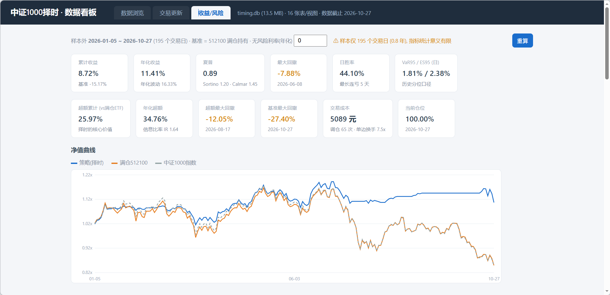
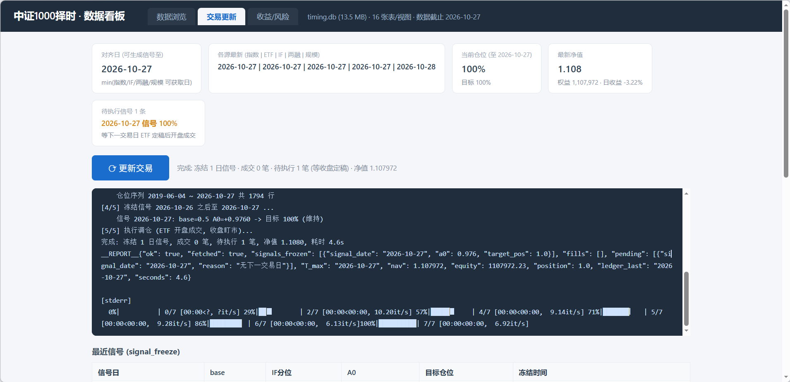
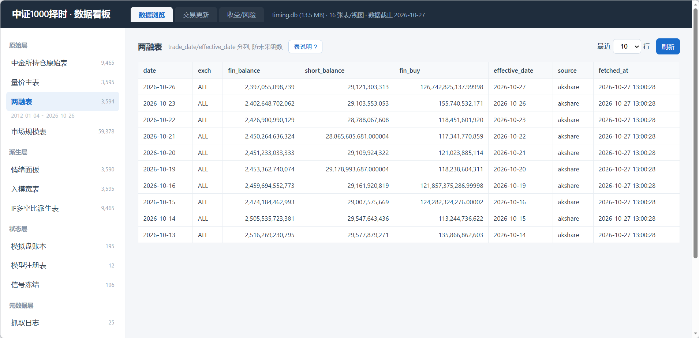

# 中证1000 日频择时

> 只做多、仓位 0–100% 可调的日频择时系统：**量价 + 资金面**决定方向（三档），**股指期货持仓情绪**只修正半仓档。
>
> 回测 2019-06 ~ 2026-09（1780 个交易日）：年化 **20.59%**、夏普 **1.19**、最大回撤 **-25.1%**；
> 同期中证1000 买入持有：年化 4.65%、夏普 0.19、最大回撤 -46.7%。


---

## 目录

- [1. 策略逻辑](#1-策略逻辑)
- [2. 模型怎么训练、样本怎么切](#2-模型怎么训练样本怎么切)
- [3. 效果：样本内 vs 样本外](#3-效果样本内-vs-样本外)
- [4. 过拟合检测（PBO / CSCV）](#4-过拟合检测pbo--cscv)
- [5. 工程与可复现性](#5-工程与可复现性)
- [6. 模拟盘（paper trading，非实盘）](#6-模拟盘paper-trading非实盘)
- [7. 本地看板](#7-本地看板)
- [8. 局限与已否决的方向](#8-局限与已否决的方向)
- [9. 数据与许可](#9-数据与许可)

---

## 1. 策略逻辑

三层结构，全部规则集中在 `core/strategy.py` 一个文件里（回测与实盘共用同一份代码，避免口径分叉）：

```
pv  信号（150 交易日 × 8 通道量价） ─┐
                                     ├→ 各自 300 日滚动分位 → slow 量化饱和 → 0.5 : 0.5 等权
slow 信号（两融 / 市值 / 股票数等 10 维）┘
                                              ↓
                          三档 {0, 50%, 100%}（阈值 0.30 / 0.80）→ 3 日众数 → 基准仓位
                                              ↓
                      基准仓位 == 50% ？ ── 是 → 用 IF 250 日分位替换，得到连续仓位
                                          └─ 否 → 保持 0% / 100%
                                              ↓
                                   5% 网格 → 10% 死区 → 目标仓位
                                              ↓
                                   T+1 开盘执行，且只在目标变化时交易
```

| 层 | 输入 | 作用 |
|---|---|---|
| 量价（pv） | 150 交易日 × 8 通道（开高低收 / 均价 / 量 / 额 / 换手率）→ LSTM+注意力 | 与资金面共同决定**基准仓位** |
| 资金（slow） | 两融余额、融券余额、板块总市值、上市股票数、融资净买入等 10 维 → MLP | 同上 |
| 情绪（IF） | 沪深300 股指期货前 20 会员持买单量 / 持卖单量的 250 日滚动分位 | **仅在基准仓位为半仓时**替换为连续仓位 |

三个关键设计，都是被数据逼出来的：

- **三档而不是连续打分。** 合成分的中间区段没有稳定信息，切成 0 / 半仓 / 满仓后夏普反而更高，过拟合也更少。
- **10% 死区 > 5% 网格。** 网格让仓位可解释、可下单，死区让目标必须"动够 10%"才触发调仓，单边换手从 18.9 降到 17.1，年化成本 0.57% → 0.51%。
- **T+1 开盘成交，不在两次调仓之间做日度再平衡。** 这是唯一在现实中能执行的路径；把成交时点挪到 T+2，夏普直接掉 0.12。

## 2. 模型怎么训练、样本怎么切

两个模型（pv / slow），每个跑 **6 个随机种子**，预测取 6 seed 平均，用来压掉单次训练的随机性。

**逐年 walk-forward，每年一个模型：**

| 数据段 | 用途 |
|---|---|
| `Y-3` 年之前（含更早） | **训练集** |
| `[Y-1, Y)` 前两年 | **验证集 / 早停** |
| `Y` 年全年 | **测试集（该年从未参与训练与调参）** |
| 训练段与验证段之间留 11 个交易日的 embargo | 防止标签窗口跨期泄漏 |

所以 **2019–2025 的每一年都是"只用当年之前的数据"训练出来的滚动样本外**，而不是用全历史训练完再回头打分。

**2026 年**是最后一层留出：`models/` 里只有 2026 的检查点，因为 2026 年之后的数据是**真正没参与过任何训练和验证**的样本外测试集。仓库里只保留这一年的模型，第 3 节的样本外结论用它算。

> 诚实说明：模型侧是严格样本外，但**策略层超参**（三档阈值、众数天数 k=3、300 日窗口）是在 2025 年底定型的，其中 k=3 在 2026-10-27 用全历史做过一次全扫描确认。因此 2026 对策略层不是"绝对干净"的样本外 —— 这一点由第 4 节的 PBO 检验兜底，而不是靠一句"样本外"糊过去。

## 3. 效果：样本内 vs 样本外

口径统一为 `core/replay.py`：T 日收盘出信号 → **T+1 开盘价成交**、只在目标变化时交易、单边 3bp。

### 3.1 三个版本对照（2019-06-04 ~ 2026-09-30）

| 版本 | 累计收益 | 年化 | 夏普 | 最大回撤 | 调仓次数 |
|---|---|---|---|---|---|
| 基准：中证1000 买入持有 | 38.9% | 4.65% | 0.19 | -46.7% | — |
| M3：量价 + 资金面（无情绪层） | 118.2% | 11.05% | 0.71 | -33.9% | 153 |
| **最终版：+ 情绪层修正** | **328.3%** | **20.59%** | **1.19** | **-25.1%** | 444 |

超额：年化 +15.94pct、IR 1.01、**t = 2.69**；月度胜率 59%；上行捕获 82%、下行捕获 24%。

三层改进各自贡献：量价+资金面模型（0.19 → 0.71）、情绪层时点选择（0.71 → 1.19）、执行与仓位规则（网格/死区）。情绪层的增益**全部来自时点选择**——把情绪降级成等仓位恒定折扣的对照组，夏普不变。

### 3.2 分年（策略 / 基准）

| 年份 | 策略收益 | 策略夏普 | 策略最大回撤 | 基准收益 |
|---|---|---|---|---|
| 2019（6 月起） | +9.7% | 1.14 | -7.3% | +7.9% |
| 2020 | +36.1% | 1.83 | -8.7% | +19.4% |
| 2021 | +6.0% | 0.94 | -5.2% | +20.5% |
| 2022 | +7.4% | 0.39 | -25.0% | **-21.6%** |
| 2023 | +5.5% | 0.52 | -10.6% | -6.3% |
| 2024 | +61.1% | 1.97 | -21.6% | +1.2% |
| 2025 | +30.0% | 1.31 | -16.5% | +27.5% |
| **2026（样本外）** | **+14.1%** | **1.17** | **-8.0%** | **-3.9%** |

没有一年亏损；但 2021 年明显跑输基准 14.5pct（结构性行情里量价因子失效），这个短板在下面第 8 节展开。

### 3.3 样本内 / 样本外分开看

| 区间 | 交易日 | 策略年化 | 策略夏普 | 策略回撤 | 基准年化 | 基准夏普 |
|---|---|---|---|---|---|---|
| 样本内 2019-06 ~ 2025-12 | 1599 | 20.84% | 1.19 | -25.1% | 6.09% | 0.25 |
| **样本外 2026-01 ~ 2026-09** | **181** | **18.42%** | **1.17** | **-8.0%** | -5.54% | -0.19 |

样本外这 181 个交易日，策略年化 18.42%、夏普 1.17，与样本内的 20.84% / 1.19 基本同水平，而同期基准是 -5.54%。**但要清醒：181 天只有 8.6 个月，一次行情就能改写这个数**（第 8 节第 1 条）。

## 4. 过拟合检测（PBO / CSCV）

这是这个项目里最容易被质疑的地方：参数量、阈值、窗口、组合权重、情绪开关，都是人挑的，凭什么不是挑出来的？

用 Bailey 等人的 **CSCV**（组合对称交叉验证）直接量化：把回测期切成 S 个连续块，枚举所有"一半当样本内、一半当样本外"的组合，看样本内最优的那个配置在样本外排到第几名，最后算 **PBO = P(样本外跌到中位数以下)**。

| 候选集 | 配置数 | PBO | 解读 |
|---|---|---|---|
| **参数层**：窗口 × 阈值 × k × 饱和 × 权重 × 情绪 × 网格/死区 | 864（去重后） | **11.9%** | 不过拟合。切分粒度 S=10 / 20 时分别为 15.9% / 18.4% |
| **结构层**：6 种量价口径 × 上述参数 | 288 | **29.7%** | 有约三成概率选错口径，是剩余风险的主源 |

**判据换成"年化收益"而不是夏普，PBO 仍是 12.0%**，说明结论不是指标选的。


三个值得说的细节：

1. **出厂配置只排 65/1152（参数层）、8/288（结构层）——不是第 1 名。** 如果当初是拿全样本 argmax 挑参数，它应该排第 1，那种做法才是过拟合的标配。
2. **PBO 不能跨候选集比较。** 加入 24 组明显更差的候选（关掉情绪层）后，PBO 从 39.7% 掉到 3.5%，而"样本内最优是关掉饱和"的比例两次都是 45%——变的是分母，不是稳定性。这条是我在做分层测试时踩到的坑。
3. **选口径这步是稳的，选完口径再调参才是风险源。** 固定参数只比 6 个口径：样本内最优的口径进样本外前 3 名的概率 **74.1%**（随机 50%）、落到末名只有 **5.4%**（随机 16.7%）。但每个口径各自调完参再比：51.4% / 16.9%，和随机没差别。

完整方法、稳健性（S=10/16/20、判据替换、DSR=0.87、偏度峰度）与逐组明细见 [PBO_CSCV_过拟合检验.md](05_报告与图表/PBO_CSCV_过拟合检验.md)，复现脚本见 `archive/research/4.6_PBO过拟合检验/`。

## 5. 工程与可复现性

**技术栈**：Python 3.12 + PyTorch（LSTM / MLP，CPU 可训练）+ pandas / numpy + SQLite；看板用 Node 22 内置 `node:sqlite`，**零第三方依赖**。

```
core/        通用代码 8 个：模型、replay.py（唯一绩效口径）、strategy.py（策略规则）、
             读数据、模型存取、自检
live/        实盘链路 5 个：db_fetch（抓数）/ db_build（重建特征）/ db_update（记账）/
             model_registry（模型缺则训练）/ config
dashboard/   本地看板：index.html + server.js + 打开看板.bat
db/          SQLite schema 与 CSV→DB 导入脚本（库文件本体不入库）
archive/     research/（PBO 检验等）、reports/、signals/_train_out/（6-seed 逐年信号，生产链路必需）
models/      pv / slow × 6 seed × 2026 的检查点
05_报告与图表/ 研究报告与图
docs/        开发手册（原 README，含全部细节）
```

**数据层是 SQLite 四层结构**（`raw` / `derived` / `state` / `meta`），核心是两道闸门：

- `provisional` 与 `final` 状态分离——盘中快照永远进不了模型，训练/回测只读 `v_features_final` 视图；
- 两融数据用 `effective_date = T+1` 表达披露滞后，查询按 `effective_date <= T` 取，而不是靠"记得滞后一天"的纪律。

### 这个仓库能怎么验

数据受许可限制没有入库（见第 9 节），所以 clone 下来先能验这两件事：

```powershell
# 不需要任何数据：直接重画第 4 节的 PBO 四联图（读已存的收益矩阵）
python archive\research\4.6_PBO过拟合检验\pbo_figure.py

# 路径自检 + 全量语法编译
python _paths.py
python -m compileall core live dashboard db archive
```

数据就位后（`data/README.md` 有字段与获取方式），可以复算全部绩效：

```powershell
python core\selftest.py    # 逐项比对 core 重算结果与已发布报告，任何不符 exit 1
```

## 6. 模拟盘（paper trading，非实盘）

> **这不是实盘。** 没有一分真实资金成交过，所有"账本"都是按真实规则纸面记账。

两本账，按时间顺序：

| 账本 | 区间 | 期末净值 | 累计收益 | 年化 | 夏普 | 最大回撤 |
|---|---|---|---|---|---|---|
| 早期 CSV 账本（中证1000 指数口径） | 2019-06 ~ 2026-10 | 4.2066 | +320.66% | 20.18% | 1.19 | -25.0% |
| 现行 DB 账本（**ETF 512100**，可真实下单） | 2026-01-05 ~ 2026-10-27（195 行） | 1.1080 | +8.72% | 11.41% | 0.89 | -7.88% |

换 ETF 的原因很实际：指数不能下单，512100 是跟踪中证1000 的可交易品种，用它记账才能把"能不能真的成交"体现出来。现行账本累计成本 5,089 元（约占初始资金 0.51%），调仓 65 次、单边换手 7.5 倍。同期满仓 512100 是 **-15.17%**——这段不择时是亏的。

账本设计上有一条硬规则：**`ledger` 表 append-only，永不 UPDATE**。记错了就用下一行反向冲销，这样每一笔调仓都有据可查，回放时能精确复原当时的仓位与现金。

## 7. 本地看板

`dashboard/` 是一个零第三方依赖的本地看板（Node 22+ 内置 `node:sqlite`）：净值曲线、表浏览器、一键「更新交易」（会 spawn Python 跑 `live/db_update.py --fetch`，把抓数→重建特征→冻结信号→记账串成一个事务）。

```powershell
node dashboard\server.js --port 7100     # 或双击 dashboard\打开看板.bat
```

Python 解释器默认取 PATH 上的 `python`，可用环境变量 `PYTHON` 指定：

```powershell
$env:PYTHON = "C:\path\to\python.exe"; node dashboard\server.js
```

> **看板需要本地的 `db/timing.db`，在 GitHub 上打不开。** GitHub 不执行 Node，Pages 也不行。



样本外（2026-01-05 ~ 2026-10-27，195 个交易日）的实时绩效页：累计 **+8.72%**、年化 11.41%、夏普 0.89、最大回撤 -7.88%，同期满仓 512100 是 -15.17%，超额 +25.97%、IR 1.64。页面上那行黄色提示是它自己给的告诫——**195 个交易日的统计意义有限**，也就是第 8 节第 1 条说的事。

> 注意这里的两条基线不是同一条序列：看板的基准是**满仓 512100**（起算 2026-01-05），第 3 节的是**中证1000 指数**（起算 2026-01-01）。差在标的（ETF 有跟踪误差与分红）与起点，不代表口径打架。

<details>
<summary>展开：交易更新 / 数据浏览</summary>

**交易更新**——一次完整日更的现场：各源最新日、待执行信号、执行日志与当日冻结结果。



**数据浏览**——16 张表 / 视图逐页翻；两融表上标了 `trade_date` / `effective_date` 的分工（后者是防未来函数的那一列）。



</details>

## 8. 局限与已否决的方向

**已知局限（按重要性排序）：**

1. **样本外只有 181 个交易日（8.6 个月）。** 样本内 1599 日、样本外 181 日，这个不对称是这份工作最大的短板——2026 恰好是基准下跌 5.5% 的年份，低仓位策略天然占便宜，不能排除"这一年赚的是 beta 而非 alpha"。
2. **策略层超参参考过 2026。** k=3 是 2026-10-27 用全历史扫描确认的，因此 2026 对策略层不是绝对干净的留出集。模型侧是干净的。
3. **结构层 PBO 29.7%**：约三成概率量价口径选错。选错平均损失 0.28 夏普（中位 0.23）。这也是我停止继续调口径的原因。
4. **2021 年跑输基准 14.5pct。** 结构性行情（小盘成长、赛道轮动）里量价因子与两融信号同时钝化，三档规则会把仓位压在低档。
5. **情绪层在衰减。** 分年 IC：2025 年 -0.299、2026 年 -0.096，2025–2026 合并的 OOS 增量是 -0.159 夏普。这个因子可能正在失效。
6. **成本与执行敏感。** 单边 3bp 下夏普 1.19，20bp 下降到 1.024；把成交时点挪到 T+2 掉 0.12、T+3 掉 0.17。实盘滑点若显著高于 3bp，结论要打折。
7. **不覆盖流动性踩踏。** 2024 年初小微盘危机那一段，模型日均仓位仍有 64%，没有识别出"跌得快 + 流动性枯竭"这种非平稳状态。
8. **36 组 seed 里并非全胜**：Δ夏普均值 +0.279、正占比 97%，但最差的一组是 -0.017。

**试过并否决的方向**（写出来是为了省掉后来者的时间）：20 日标签、滚动 z-score 标准化、合成后重排序（0.66 → 0.46）、仓位层加权（0.662 → 0.341）、波动率目标（0.58 → 0.35）、条件期望映射、三期 IC、双期 MSE 作为合并输入、把情绪当第三打分项、软减 S1/S2、Aup 只加不减、A0+V 叠加、冷却 20 日、复合触发加确认条件。

## 9. 数据与许可

- **数据不入库。** 中证1000 行情、两融、市场规模、股指期货会员持仓均来自 CSMAR / 交易所公开接口，**许可不允许再分发**；`07_参考资料/` 的券商研报同理。仓库只放代码、模型与结果，不放原始数据。字段定义与获取方式见 [data/README.md](data/README.md)。
- **模型检查点入库**（1.2MB），因为它是这份工作的产出物，不是数据。
- **许可**：代码 MIT。**免责**：本项目为研究与工程练习，不构成任何投资建议。

---

**继续读**：[docs/开发手册.md](docs/开发手册.md)（原 README，含逐脚本说明、路径常量、每日时点表、数据字段、历史日志索引）
｜ [05_报告与图表/](05_报告与图表/)（研究记录、方案对照回测、PBO 完整报告）
｜ [05_报告与图表/简历项目_中证1000择时信号体系.md](05_报告与图表/简历项目_中证1000择时信号体系.md)（一页版）
