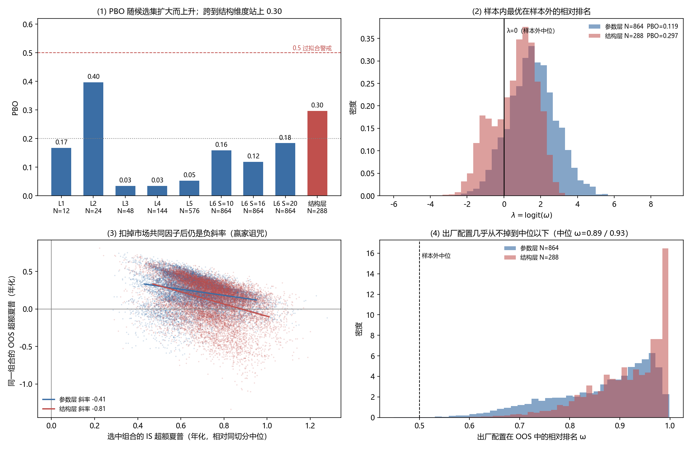

# PBO / CSCV 过拟合检验 —— 中证1000 择时（M3）

> **一句话**：补上 README 里自认的"唯一空白"。**参数层 PBO ≈ 12%**（S=16，下附 S=10/20 与判据稳健性），
> **跨到"量价口径"这一结构维度后升到 30%**。两者都远低于 0.5 的过拟合警戒线；出厂配置在每一次切分里
> 的样本外相对排名中位数为 **0.89（参数层）/ 0.93（结构层）**，**几乎从不掉到中位以下**。
> 真正的风险不在 0.30/0.80、k=3、5% 网格这些参数上，而在"选哪套量价口径"。
>
> 检验日期 2026-10-27　脚本 `archive/research/4.6_PBO过拟合检验/pbo_cscv.py`　全量跑完 **42 秒**

---

## 1. 要回答的问题

这套参数是看着 2019–2026 全样本定下来的：300 日滚动分位、0.30/0.80 三档、k=3 众数、
slow 量化饱和、0.5:0.5 等权、情绪层只在半仓接管、5% 网格 + 10% 死区。

问题不是"它历史上好不好看"（那个已知：夏普 1.19），而是：**如果换一段样本，还会挑出同一套吗？**

PBO（Probability of Backtest Overfitting, Bailey–Borwein–López de Prado–Zhu 2014）正好回答这个：
把样本切成多块、半数当样本内半数当样本外，看"样本内最优"在样本外落到中位以下的频率。

## 2. 做法（口径全部沿用项目现有引擎，没有第二套）

| 环节 | 做法 |
|---|---|
| 候选集 A（参数层） | 1152 组：窗口 {200,250,300,400} × band {(0.25,0.75),(0.30,0.70),(0.30,0.80),(0.35,0.85)} × k {1,3,5} × 饱和 {开,关} × 权重 {0.3,0.5,0.7} × 情绪 {开,关} × 网格/死区 {(0.05,0.10),(0.10,0.15)}；去重后 **864 组** |
| 候选集 B（结构层） | 288 组：量价口径 {main, h10, h20, d5_10_ic, d5_10_mse, d5_10_20_ic} × 上述 4 档 band × 3 种 k × 饱和 × 情绪。六种口径全部来自 `archive/signals/_train_out/` 里**当年真实跑过、后被否决**的信号，不是编的对照组 |
| 仓位生成 | `core/strategy.py`（唯一真身），未改一行参数逻辑 |
| 绩效 | `core/replay.py` —— T 日信号 → T+1 开盘成交、只在目标变化时交易、单边 3bp。**唯一绩效口径** |
| 区间 | 2019-06-04 ~ 2026-09-30，1780 个交易日 |
| CSCV | S 个连续块，枚举全部 C(S,S/2) 种"一半 IS / 一半 OOS"；每次 IS 取夏普最高者，算它在 OOS 的相对排名 ω=rank/(N+1)，λ=logit(ω)；**PBO = P(λ≤0)**。S=16 → 12870 次切分 |

出厂配置在候选集里的检验：main 口径 + 全部出厂参数，单跑复现 **夏普 1.1922 / 累计 4.2828 / 回撤 −25.13% / 调仓 444 次**，
与 `core/selftest.py` 的报告完全一致——说明候选集里的"出厂那一格"就是线上跑的那条，没有走样。

## 3. 结果

### 3.1 参数层：候选集逐级扩大

| 层级 | 放进来的新维度 | 候选数(去重) | **PBO** | λ 中位 | 选中者的 IS 超额 | 选中者的 OOS 超额 |
|---|---|---|---|---|---|---|
| L1 | band × k | 12 | 0.168 | +0.81 | +0.22 | +0.07 |
| L2 | + 饱和开关 | 24 | **0.397** | +0.24 | +0.26 | +0.00 |
| L3 | + 情绪开关 | 48 | 0.035 | +1.24 | +0.53 | +0.28 |
| L4 | + 合成权重 | 144 | 0.034 | +2.09 | +0.65 | +0.37 |
| L5 | + 分位窗口 | 576 | 0.053 | +1.93 | +0.77 | +0.34 |
| **L6** | + 网格/死区 = **出厂全网格** | **864** | **0.119**（S=16） | +1.55 | **+0.67** | **+0.23** |

（"IS 超额 / OOS 超额"= 选中组合的夏普减去**同一次切分里全部候选的中位数**，年化单位。
扣掉这个共同项，才能把"市场这段好不好"和"选得准不准"分开。）

稳健性：L6 在 S=10 时 PBO=**0.159**、S=20 时 **0.184**；把判据从夏普换成**年化收益**，PBO=**0.120**；
选中组合在样本外亏钱的概率 P(OOS 夏普≤0) = **0.2%**。

**读法**：全部方向层参数都放开（864 组）后，PBO 只有 12%，对应的经验判据是"不构成系统性过拟合"。
但 **L2 的 0.397 不是噪声**，它指着具体一个开关（见 §3.4）。

### 3.2 结构层：把量价口径也摆上擂台，PBO 抬到 30%

| S | 候选数 | **PBO** | λ 中位 | OOS 超额 |
|---|---|---|---|---|
| 10 | 288 | **0.397** | +0.41 | +0.04 |
| 16 | 288 | **0.297** | +0.81 | +0.11 |
| 20 | 288 | **0.381** | +0.44 | +0.04 |

六种量价口径在全样本上的分布（每种 48 个参数组合）：

| 口径 | 夏普均值 | 夏普最高 | 说明 |
|---|---|---|---|
| **main**（现行 8 通道） | **+0.829** | **+1.233** | 出厂所用 |
| d5_10_20_ic | +0.844 | +1.233 | 均值略高，与 main 相关 0.944 |
| h10 | +0.791 | +1.117 | 10 日标签 |
| d5_10_mse | +0.686 | +0.975 | 双期 MSE 合并 |
| h20 | +0.558 | +1.076 | 20 日标签 |
| d5_10_ic | +0.326 | +0.735 | 双期 IC 合并，最差 |

**读法**：一旦把"选哪套量价口径"也当成一条试验计入，PBO 从 0.12 跳到 **0.30**。
换句话说——参数怎么调都不太会挑错，但**"选了口径"这一步本身带了 30% 的选错概率**。
这和 README 里"20 日标签已否决""合成后重排序已否决"那些记录是同一件事的量化版本。

#### 3.2b 口径维单独拆开：风险在"选完口径再调参"，不在"选口径"

| 对照 | 候选 | 结果 |
|---|---|---|
| 口径固定为出厂参数，**只**比口径 | 6 | IS 最优口径进 OOS 前 3 名 **74.1%**（随机 50%），落到末名仅 **5.4%**（随机 16.7%） |
| 每个口径各自在样本内挑最优参数，再比口径 | 6 × 48 | IS 最优口径进前 3 名 **51.4%**、末名 **16.9%** —— **恰好等于随机** |
| 各口径内部单独做 CSCV（48 组参数） | 48 | main **0.044** / d5_10_ic 0.060 / d5_10_20_ic 0.082 / h10 0.179 / h20 0.180 / **d5_10_mse 0.575** |

1. **口径排序本身是稳的**：参数固定后 main 与 d5_10_20_ic 稳定占前二（OOS 平均名次 1.89 / 1.82），
   d5_10_ic 稳定垫底（5.57）。74% 选进前三 ⇒ "选 main"这一步没有踩空。
2. **一拍上参数自由度，排序就消失**：允许每个口径自己挑参数后，IS 最优口径的样本外名次与随机无异。
   **那 30% 主要不是"选错了口径"，而是"口径 × 调参"的联合搜索。**
3. **各口径抗过拟合能力差很多**：main 内部 PBO 仅 4.4%，d5_10_mse 高达 57.5% —— 后者"好看"是参数挑出来的，
   被否决是对的。
4. **梯队内部不可分辨**：main（1.192）与 d5_10_20_ic（1.233）只差 0.04，而切分内口径间的 OOS 夏普极差平均 0.92。
   能说的是"main 属第一梯队"，**不能说**"main 是最优口径"。

### 3.3 出厂配置站在哪

- 参数层：全样本夏普 **1.1922，排 65 / 1152**（p10=0.51 / 中位=0.75 / p90=1.13）。
- 结构层：**排 8 / 288**。
- 全样本最优是 `win400 + wpv0.70 + band0.30-0.80`（夏普 **1.426**，回撤 −22.1%），比出厂高 0.23；

> **这一点很关键，且是正面证据**：如果作者是"按全样本夏普 argmax"挑参数，出厂配置应该排第 1。
> 它排第 65 / 第 8，说明当初的取舍不是拿全样本最优当目标（大概率是看四舍五入到 0.05 网格、
> 等权 0.5、以及可解释性）。**没有把样本内最优写进出厂配置，是过拟合风险最低的一种自觉。**

### 3.4 唯一真正的"掷硬币"维度：slow 量化饱和

L2 的 0.397 与"样本内选中 sat=0 的比例 45.04%"几乎重合。逐切分看：

| 候选集 | sat=0 被选中的比例 | 其中 λ<0 的比例 | sat=1 被选中时 λ<0 的比例 |
|---|---|---|---|
| L2（24 组） | 45.04% | **57.6%** | 25.1% |
| L3（48 组） | 45.04% | 4.7% | 2.5% |

同一个选择行为，在两个候选集里的 PBO 差了 11 倍。**这不是数据变了，是分母变了**——L3 里那 24 组
"关掉情绪层"的候选明显更差，稳稳占住排名底部，把胜者的相对排名机械抬了上去。

结论两条：
1. **饱和开关是真不稳定**：45% 的子样本里"不做饱和"更好，换一半样本就翻面。出厂选"做饱和"是对的
   （全样本均值更高），但它不是一个稳健到可以忽略的选择。
2. **PBO 不能跨候选集比较**——详见 §4。

## 4. 方法学警告（写报告时必须带上）

**PBO 不是策略的属性，是"候选集 + 选择规则"的属性。** 把明显劣势的候选扔进去，PBO 会机械下降；
把结构相近但真正互相竞争的候选放进去，PBO 会上升。所以：

- 表 3.1 的 L1→L6 **不能**读成"PBO 随 N 增大而上升/下降"，只能读成"每加一个维度，风险落在哪里"。
- 任何一个 PBO 数字，脱离了它对应的候选集就没有意义。本文的两个数字分别定义在
  "864 组部署参数"和"288 组量价口径 × 参数"上，引用时必须带上这个限定。
- 这也是为什么本文同时报了 λ 分布与**出厂配置自己的 OOS 排名**——后者不依赖候选集里有没有垫底的对照组。

## 5. DSR（Deflated Sharpe Ratio）

按 864 次试验折算（Bailey–López de Prado 的 SR0 公式，含偏度/峰度修正）：

| 项 | 值 |
|---|---|
| 出厂策略夏普（年化） | 1.1922 |
| 试验次数 N | 864 |
| 零假设下的期望最大夏普 SR0（年化） | **0.7585** |
| **DSR = P(真实夏普 > SR0)** | **0.8718** |
| 日收益偏度 / 峰度 | +0.145 / 30.45 |

即使把 864 次试验的选择性全部计入，1.19 的夏普仍有 **87%** 的概率不是多重比较的产物。
副作用提醒：日收益峰度 30.5，厚尾极重——夏普本身对尾部不敏感，实盘尾部风险看回撤与杠杆，不看这个数。

## 6. 局限（照实写）

1. **只覆盖了能用日收益矩阵还原的维度**：部署层参数 + 六种量价口径。README 里其它结构性方案
   （20 日标签、滚动 z-score、合成后重排序、仓位层加权、波动率目标、条件期望映射、三期 IC、
   软减 S1S2、Aup 只加不减、A0+V 叠加、冷却 20 日、复合触发）**无法从存档还原成逐日收益**，
   因此没有进候选集。**真实 PBO 不小于本文数字**——本文是下界。
2. **试验次数被低估**：还跑过 36 组 seed × 多个 train_dir 版本、h10/h20 的多种合并方式。
   DSR 里的 N 只取了 864（部署网格），没有把早期模型训练试验算进去。
3. **CSCV 假设块可交换**：A 股有明确的牛熊分段，S=10/16/20 的结果差异（0.16/0.12/0.18）就来自这里；
   已用三个 S 报区间而非单点。
4. **成本口径单一**：全部按单边 3bp。20bp 下策略夏普 1.024（README 已测），PBO 未在 20bp 下重算。
5. **标的口径**：回测用 000852 指数、实盘用 ETF 512100，两者跟踪误差未进矩阵。

## 7. 复现

```powershell
python archive\research\4.6_PBO过拟合检验\pbo_cscv.py     # 全量，42 秒
python archive\research\4.6_PBO过拟合检验\pbo_figure.py   # 出图
```

产出：

| 文件 | 内容 |
|---|---|
| `archive/research/4.6_PBO过拟合检验/pbo_cscv.py` | 检验主脚本（候选集构造 + CSCV + DSR） |
| `archive/research/4.6_PBO过拟合检验/pbo_figure.py` | 四联图 |
| `archive/research/4.6_PBO过拟合检验/results_pbo.json` | 全部数字 |
| `archive/research/4.6_PBO过拟合检验/configs_stats.csv` | 1152 组参数层逐组绩效 |
| `archive/research/4.6_PBO过拟合检验/configs_stats_struct.csv` | 288 组结构层逐组绩效 |
| `archive/research/4.6_PBO过拟合检验/returns_matrix*.npz` | 日收益矩阵（可复用） |
| `05_报告与图表/PBO_CSCV_过拟合检验.png` | 四联图 |



## 8. 结论与建议

1. **部署参数层不过拟合**：PBO 12%（区间 11.9%–18.4%），出厂配置的 OOS 排名中位 0.89、掉到中位以下
   的概率 0.07%。这条策略的稳健性来自结构（三档 + 死区 + 情绪只在半仓接管），不是参数精调。
2. **口径层的 30% 要拆开看**：单比口径是稳的（74% 进前三、5.4% 垫底），一旦允许每个口径自己调参，
   排序就退化成随机（51.4% / 16.9%）——风险来自**"口径 × 调参"的联合搜索**，而不是"选 main 选错了"。
   这也解释了 h20 / d5_10_* 为什么该被否决：它们不是不显著（h20 全样本 0.558 并不算差），而是同参数下
   始终垫底，且内部抗过拟合能力差异极大（d5_10_mse 内部 PBO 57.5%）。
3. **建议在 README 的「风险与空白」里把 PBO 这条划掉**，替换为：
   > PBO/CSCV 已完成（2026-10-27）：参数层 PBO=12%（S=10/16/20 → 16%/12%/18%），
   > 含量价口径的结构层 PBO=30%；DSR=0.87。详见 `05_报告与图表/PBO_CSCV_过拟合检验.md`。
4. **若要继续压风险**，性价比最高的一步不是调参，而是把 h10 / h20 / d5_10_* 的样本外表现单独列一张表，
   长期跟踪"口径选择"这一维度的稳定性。
